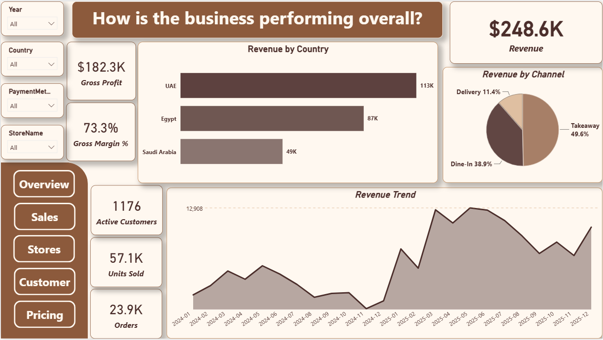
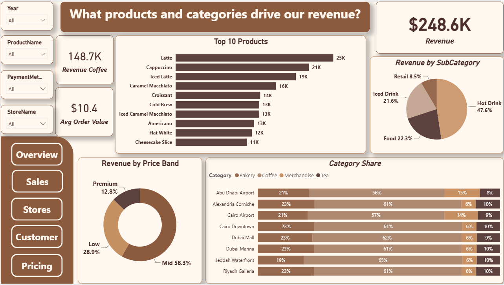
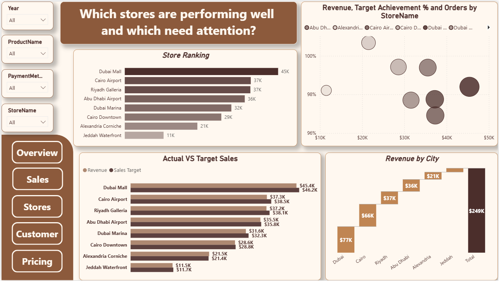
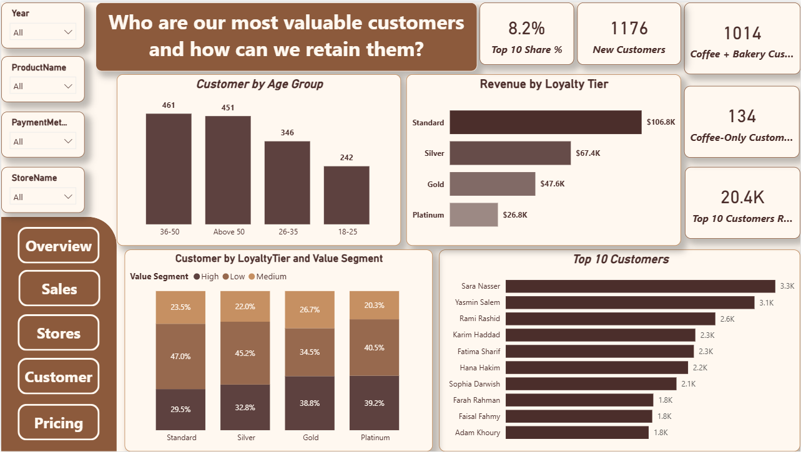
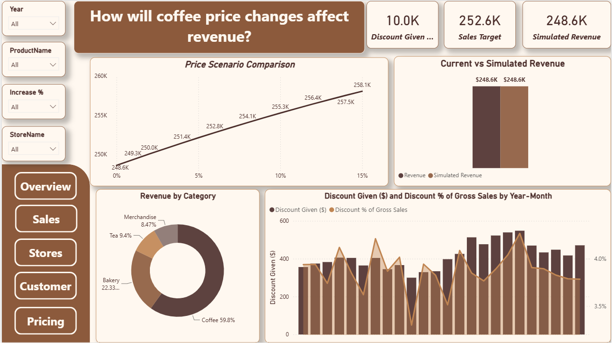

# ☕ Coffee Shop Sales Dashboard (Power BI)

An interactive, multi-page Power BI report that analyzes the sales performance of a coffee shop chain operating **8 stores across 3 countries** (UAE, Egypt, Saudi Arabia). The report answers five key business questions, from overall performance to customer loyalty and pricing strategy, covering **January 2024 – December 2025**.

---

## 📌 Table of Contents

- [Project Overview](#-project-overview)
- [Business Questions](#-business-questions)
- [Dashboard Pages](#-dashboard-pages)
- [Key Insights](#-key-insights)
- [Tools & Techniques](#-tools--techniques)
- [Repository Structure](#-repository-structure)
- [How to Use](#-how-to-use)
- [Author](#-author)

---

## 🎯 Project Overview

The goal of this project is to turn raw transactional coffee shop data into a clear, decision-ready dashboard. The report helps management monitor revenue and profitability, understand what products drive sales, compare store performance against targets, identify and retain valuable customers, and test pricing scenarios before applying them.

**Headline numbers**

| Metric | Value |
|---|---|
| Total Revenue | $248.6K |
| Gross Profit | $182.3K |
| Gross Margin | 73.3% |
| Orders | 23.9K |
| Units Sold | 57.1K |
| Active Customers | 1,176 |
| Avg. Order Value | $10.4 |

---

## ❓ Business Questions

Each page of the report is built around one question:

1. **Overview:** How is the business performing overall?
2. **Sales:** What products and categories drive our revenue?
3. **Stores:** Which stores are performing well and which need attention?
4. **Customers:** Who are our most valuable customers and how can we retain them?
5. **Pricing:** How will coffee price changes affect revenue?

---

## 📊 Dashboard Pages

### 1. Overview: How is the business performing overall?
Revenue, gross profit, margin, orders, units sold and active customers at a glance, with revenue by country, revenue by sales channel, and the monthly revenue trend.



### 2. Sales: What products and categories drive our revenue?
Top 10 products, revenue by sub-category, price band split, average order value, and category share per store.



### 3. Stores: Which stores are performing well and which need attention?
Store ranking, actual vs. target sales, target achievement vs. revenue and orders, and a revenue-by-city waterfall.



### 4. Customers: Who are our most valuable customers and how can we retain them?
Customer distribution by age group, revenue by loyalty tier, value segments within each tier, top 10 customers, and product-mix cohorts (coffee + bakery vs. coffee-only).



### 5. Pricing: How will coffee price changes affect revenue?
A price-increase simulation (0%–15%), current vs. simulated revenue, sales target tracking, revenue by category, and discount analysis over time.



---

## 💡 Key Insights

**Overall performance**
- The business generated **$248.6K** in revenue with a strong **73.3% gross margin**.
- **UAE** is the largest market ($113K), followed by **Egypt** ($87K) and **Saudi Arabia** ($49K).
- **Takeaway** is the dominant channel (49.6%), followed by Dine-In (38.9%) and Delivery (11.4%).
- Revenue dipped toward the end of 2024 and then grew strongly through 2025, peaking at around **$12.9K per month**.

**Products & categories**
- **Coffee** is the core of the business (~60% of revenue, $148.7K). Bakery follows with ~22%, then Tea and Merchandise.
- **Latte ($25K)**, **Cappuccino ($21K)** and **Iced Latte ($19K)** are the top three products.
- Hot drinks account for 47.6% of revenue and iced drinks for 21.6%.
- **Mid-priced** items generate 58.3% of revenue, while Premium items contribute only 12.8%.
- Airport stores (Abu Dhabi, Cairo) have a noticeably higher merchandise share (14–15%) than other stores (~6%).

**Stores**
- **Dubai Mall** leads with $45K, followed by Cairo Airport and Riyadh Galleria ($37K each).
- **Jeddah Waterfront** is the smallest store ($11K) and the one that needs the most attention.
- Most stores land within roughly 96–100% of their sales target, and none dramatically over- or under-performs.

**Customers**
- The **Top 10 customers account for 8.2%** of revenue, so revenue is not heavily concentrated in a few buyers.
- 1,014 customers buy both coffee and bakery items, versus only 134 coffee-only customers, which suggests a strong cross-sell habit.
- Revenue by loyalty tier: Standard $106.8K, Silver $67.4K, Gold $47.6K, Platinum $26.8K.
- Gold and Platinum tiers have the highest share of "High" value customers (~39%), which shows the loyalty program is rewarding the right behavior.
- The largest customer age groups are 36–50 and Above 50.

**Pricing**
- Total discounts given: **$10.0K**, around 3.5–4.5% of gross sales per month.
- The price simulation shows revenue rising from $248.6K to about **$258.1K at a 15% increase**, which would cover the **$252.6K** sales target.

---

## 🛠 Tools & Techniques

- **Power BI Desktop**: data modeling, visualization and report design
- **DAX**: measures for revenue, gross profit, margin %, target achievement, discount %, and price simulation
- **Power Query**: data cleaning and transformation
- **Data Modeling**: relationships between sales, products, stores, customers and date tables
- **Design**: custom coffee-themed color palette, page navigation buttons, slicers (Year, Product, Payment Method, Store, Country, Increase %)

---

## 📁 Repository Structure

```
Coffee-Shop-Sales-Dashboard/
│
├── Coffee_Shop_Sales.pbix     # Power BI report file
├── README.md                  # Project documentation
└── images/                    # Dashboard screenshots
    ├── Overview.png
    ├── Sales.png
    ├── Stores.png
    ├── Customers.png
    └── Pricing.png
```

---

## 👤 Author

**Your Name**
- LinkedIn: [www.linkedin.com/in/kirollos-sameh-12babb356](https://linkedin.com/in/your-profile)
- GitHub: [@Kirollos_Sameh096](https://github.com/your-username)
- Email: kirosameh096@gmail.com

⭐ If you found this project useful, feel free to star the repository!